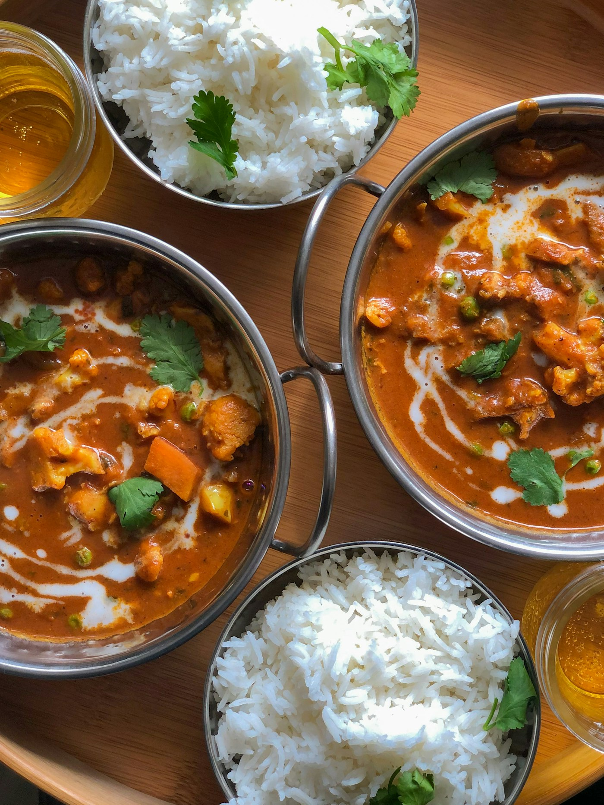
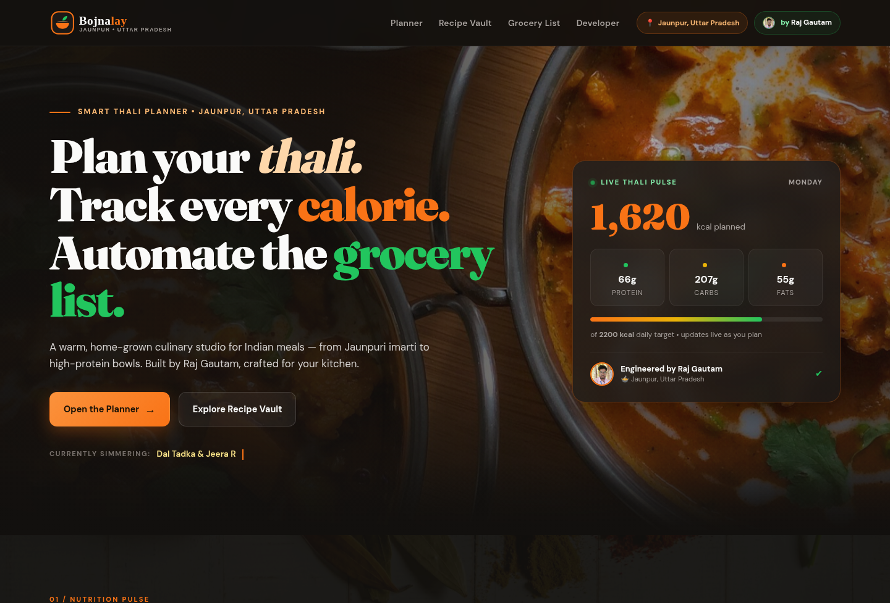
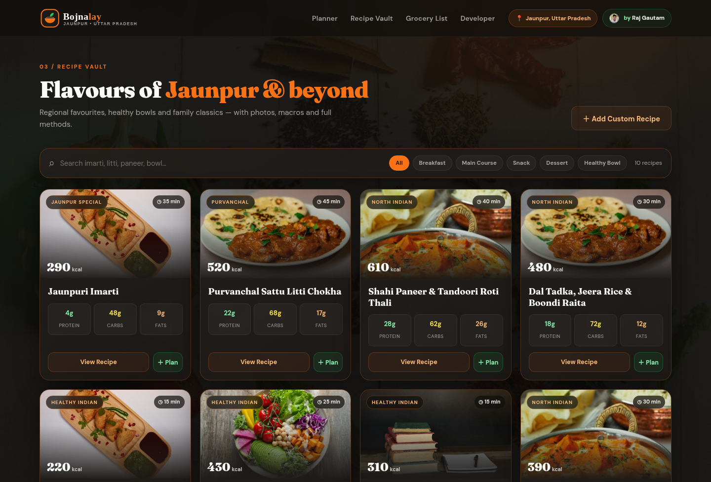
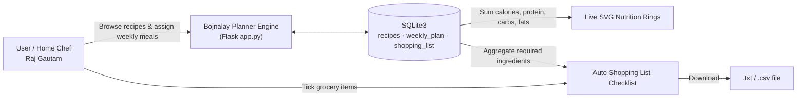

<div align="center">


<br>


<br>



<br>

[](https://www.python.org/)
[](https://flask.palletsprojects.com/)
[](https://www.sqlite.org/)
[](https://developer.mozilla.org/)
[](https://developer.mozilla.org/)
[](https://developer.mozilla.org/)
[](https://en.wikipedia.org/wiki/Jaunpur)
[](mailto:graj13099@gmail.com)
[](LICENSE)

**Smart Meal Planning · Recipes · Auto-Grocery Lists · Live Nutrition Tracking**

*“Plan Your Thali, Track Every Calorie, Automate Your Grocery List.”*

</div>

---

## ⚡ One-Line Copy–Paste — Run From Anywhere

**Terminal खोलें, किसी भी फ़ोल्डर में रहें, ये एक लाइन पेस्ट करें और Enter दबाएँ:**

```bash
git clone -q https://github.com/Rg100152/bojnalay.git && cd bojnalay && bash run_bojnalay.sh
```

ये एक लाइन सब कुछ कर देगी:

1. ✅ Repo clone करेगी
2. ✅ `.venv` virtual environment बनेगा
3. ✅ `requirements.txt` से **Flask** install होगा
4. ✅ 10 Jaunpur/Indian रेसिपीज़ + सैंपल थाली सीड होगी
5. ✅ App शुरू होकर **http://127.0.0.1:5000** पर खुल जाएगा

**पहले से clone किया हुआ है?** प्रोजेक्ट फ़ोल्डर में जाकर बस:

```bash
bash run_bojnalay.sh
```

**Windows (PowerShell):**

```powershell
git clone https://github.com/Rg100152/bojnalay.git; cd bojnalay; python -m venv .venv; .\.venv\Scripts\Activate.ps1; pip install -r requirements.txt; python seed_recipes.py; python app.py
```

**बिना virtual environment (सिर्फ़ library + run):**

```bash
pip install -r requirements.txt && python3 seed_recipes.py && python3 app.py
```

---

## 👨‍🍳 Meet the Maker

<table align="center">
  <tr>
    <td align="center" width="180">
      
    </td>
    <td>
      <h3>Raj Gautam </h3>
      <p>Full-Stack Developer from <strong>Jaunpur, Uttar Pradesh, India</strong> — building warm, useful software with a dash of local flavour.</p>
      <p>
        <a href="mailto:graj13099@gmail.com">📧 graj13099@gmail.com</a><br>
        <a href="https://instagram.com/linux.userraj" target="_blank" rel="noopener">📸 @linux.userraj</a><br>
        <a href="https://github.com/Rg100152" target="_blank" rel="noopener">🐙 github.com/Rg100152</a>
      </p>
    </td>
  </tr>
</table>

> 📍 **Local pride:** Jaunpuri Imarti, Purvanchal Sattu Litti Chokha and makhana-based chaats are first-class citizens in the recipe vault.

---

## ✨ What Bojnalay Does

| Feature | What you get |
|---|---|
| 🗓️ **7-Day Thali Planner** | Monday → Sunday with Breakfast, Lunch, Snack & Dinner slots. Tap **＋ Assign recipe** and the day's kcal update instantly. |
| 📊 **Live Macro Rings** | Animated SVG gauges for Calories, Protein, Carbs and Fats — recalculated the moment a meal changes. |
| 🍛 **Visual Recipe Vault** | 10 Indian & healthy recipes with real food photography, prep time, macro badges, filters, search and step-by-step modals. |
| 🧺 **Smart Grocery Generator** | Aggregates ingredients from every planned meal, merges duplicates and groups them by grocery aisle. Tick items, download as `.txt` or `.csv`. |
| 🌾 **Jaunpur Edition** | Regional recipes, Purvanchal touches and a warm “Saffron & Clay Culinary Studio” theme. |
| ➕ **Custom Recipes** | Add your own family recipes from the UI — they flow into the planner and grocery list automatically. |

---

## 🖼️ UI Showcase — Real Screenshots

<table>
  <tr>
    <td width="50%" align="center">
      <h3>🗓️ Weekly Thali Planner + Live Nutrition</h3>
      
    </td>
    <td width="50%" align="center">
      <h3>🍛 Visual Recipe Vault</h3>
      
    </td>
  </tr>
</table>

*Screenshots are real captures of the running Flask app, generated with `python3 capture_screenshots.py`.*

---

## 🎨 Design Language — Warm Espresso & Saffron Culinary Studio

| Token | Colour | Used for |
|---|---|---|
| Roasted Espresso | `#12100E` | Page background, deep canvas |
| Matte Charcoal Clay | `#1C1917` | Glass cards and surfaces |
| Saffron Orange | `#F97316` | Brand, calories, primary buttons |
| Fresh Mint | `#22C55E` | Protein, healthy accents |
| Turmeric Gold | `#EAB308` | Carbs, energy highlights |

A low-opacity spices texture (`bg-spices.jpg`) sits under the UI, while the hero uses a royal thali banner with a glassmorphic overlay and the 📍 Jaunpur, Uttar Pradesh badge.

---

## 🔄 Data Flow Diagram



---

## 🚀 Quick Start

```bash
# 1. Clone
git clone https://github.com/Rg100152/bojnalay.git
cd bojnalay

# 2. Virtual environment
python3 -m venv venv
source venv/bin/activate        # Windows: venv\Scripts\activate

# 3. Dependencies
pip install -r requirements.txt

# 4. Seed 10 recipes + sample weekly thali
python3 seed_recipes.py

# 5. Run the studio
python3 app.py
```

Open **http://127.0.0.1:5000** in your browser.

> The database is created automatically at `database/bojnalay.db` on first run.

---

## 🔌 API Endpoints

| Method | Endpoint | Purpose |
|---|---|---|
| `GET` | `/` | Renders the Culinary Studio UI |
| `GET` | `/api/recipes?search=&category=` | Search / filter the recipe vault |
| `POST` | `/api/recipes` | Add a custom recipe |
| `GET` | `/api/plan` | Weekly plan and per-day / week totals |
| `POST` | `/api/plan` | Assign or clear a `{day, slot, recipe_id}` |
| `DELETE` | `/api/plan` | Clear the whole week |
| `GET` | `/api/nutrition?day=Monday` | Macro ring values and percentages |
| `GET` | `/api/shopping` | Grouped grocery checklist |
| `POST` | `/api/shopping/generate` | Rebuild list from the weekly plan |
| `PATCH` | `/api/shopping/<id>` | Tick / untick an item |
| `POST` | `/api/shopping/clear` | Empty the grocery list |
| `GET` | `/api/shopping/download?format=txt\|csv` | Download the grocery list |
| `GET` | `/api/health` | Health + record counts |

---

## 📁 Project Structure

```text
bojnalay/
├── app.py                      # Flask server, planner, nutrition & grocery APIs
├── seed_recipes.py             # 10 Jaunpur / Indian / healthy recipes + sample plan
├── run_bojnalay.sh             # ⚡ One-command setup + launch (venv, install, seed, run)
├── capture_screenshots.py      # Headless Chrome screenshot generator (optional)
├── requirements.txt            # Flask
├── README.md                   # This dynamic, animated README
├── .gitignore                  # venv, __pycache__, *.db
├── database/
│   └── bojnalay.db             # SQLite database (generated)
├── templates/
│   ├── base.html               # Navbar, logo, dev pill, footer credits, modals
│   └── index.html              # Hero, rings, planner, vault, grocery list
└── static/
    ├── css/bojnalay.css        # Warm Espresso & Saffron Culinary Studio UI
    ├── js/bojnalay.js          # Slot assigner, macro calculator, checklist
    └── assets/
        ├── logo-bojnalay.svg   # Saffron bowl + mint leaf + Jaunpur subtitle
        ├── readme-typing.svg   # Animated typing banner
        ├── raj-gautam.png      # Developer profile photo
        ├── banner.jpg          # Royal Indian thali hero banner
        ├── bg-spices.jpg       # Subtle culinary background texture
        ├── food-*.jpg          # Recipe cover photography
        ├── screenshot-planner.png
        └── screenshot-recipes.png
```

---

## 🧪 Regenerate the Screenshots

```bash
pip install websocket-client     # only needed for screenshot capture
python3 app.py &                 # start the server first
python3 capture_screenshots.py http://127.0.0.1:5000
```

---

## 🔒 Privacy

No phone number, no analytics, no external tracking. Contact is **email and Instagram only**: `graj13099@gmail.com` · `@linux.userraj`.

---

<div align="center">

### Crafted with 🍲 in Jaunpur, Uttar Pradesh

**Raj Gautam** · [GitHub](https://github.com/Rg100152) · [Instagram @linux.userraj](https://instagram.com/linux.userraj) · [Email](mailto:graj13099@gmail.com)

*“Plan your thali. Track every calorie. Automate your grocery list.”*

</div>
